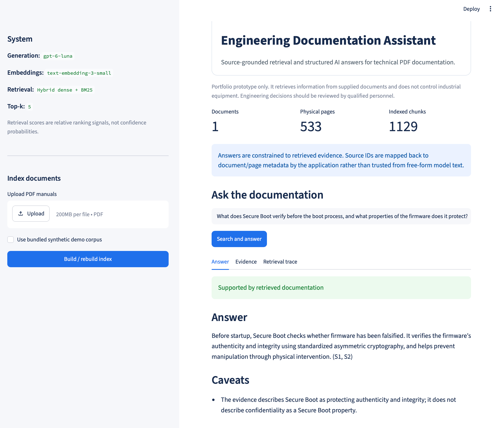
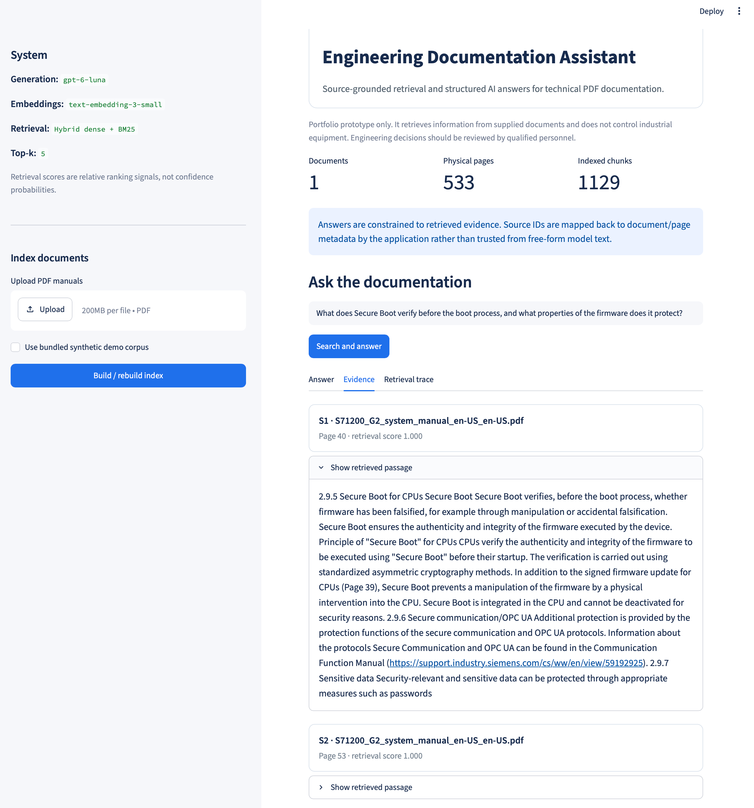
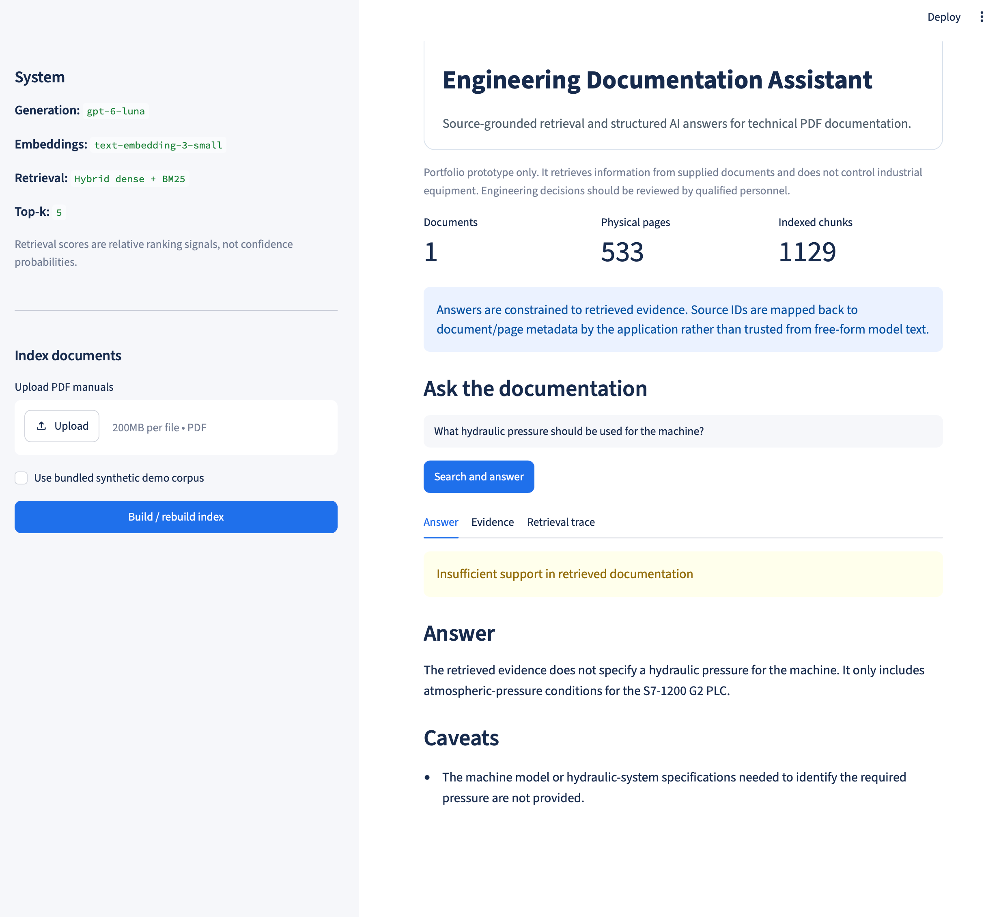
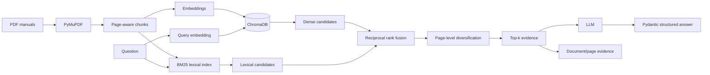

# Engineering Documentation Assistant

A source-grounded retrieval-augmented generation (RAG) prototype for searching technical PDF documentation and producing structured answers with traceable page evidence.

> **Scope:** information retrieval and decision support only. This project does not connect to or control PLCs or other industrial equipment.

## Why this project exists

Engineering documentation can be long, repetitive and difficult to search during troubleshooting. This project explores whether hybrid retrieval and an LLM can surface relevant evidence while keeping answers traceable to physical PDF pages and explicitly handling questions that are not supported by the indexed documentation.

## Demo

### Grounded technical answer

The application retrieves relevant passages from the indexed documentation, generates an answer constrained to that evidence, and maps cited source IDs back to physical PDF pages.



### Source traceability

Users can inspect the exact document pages and retrieved passages used to support an answer.



### Unsupported-query handling

When the indexed documentation does not provide sufficient evidence, the application avoids presenting an unsupported engineering answer.



## What it demonstrates

- Python application development
- PDF extraction with physical page metadata
- page-aware text chunking
- OpenAI embeddings
- persistent vector search with ChromaDB
- BM25 lexical retrieval for exact engineering terminology
- reciprocal rank fusion (RRF)
- page-level retrieval diversification
- retrieval-augmented generation (RAG)
- OpenAI Responses API
- typed structured output with Pydantic
- source-aware Streamlit UI
- unsupported-query handling
- labelled retrieval evaluation and failure analysis
- development / holdout evaluation separation
- unit tests, CI and documented limitations

## Architecture



## Real-manual evaluation

The real-document experiment used the following publicly available technical manual:

- **Document:** SIMATIC S7-1200 G2 Programmable Logic Controller System Manual
- **Version:** V4.1
- **Date:** 12/2025
- **Document ID:** A5E52923928-AC
- **Source:** Siemens Industry Online Support
- **Source URL:** https://support.industry.siemens.com/dl/files/791/109997791/att_1350879/v1/S71200_G2_system_manual_en-US_en-US.pdf
- **Accessed:** 29 September 2026
- **Physical PDF pages:** 533
- **Indexed chunks:** 1,129
- **SHA-256:** `5c46f14aca74ed9387726c32b16ff2913a081160b442d760d0b22d05bb623ed6`

The Siemens PDF is intentionally **not redistributed** with this repository. Exact download, checksum and reproduction instructions are documented in [`data/README.md`](data/README.md).

No affiliation with or endorsement by Siemens is implied.

### 15-question development set

The development set was used for failure analysis and retrieval iteration. Page labels were manually adjudicated when more than one physical PDF page independently contained enough evidence to answer a question.

| Metric | Dense retrieval | Hybrid retrieval |
| --- | ---: | ---: |
| Page Recall@1 | 0.467 | **0.667** |
| Page Recall@3 | 0.867 | **0.933** |
| Page Recall@5 | **0.933** | **0.933** |
| Page MRR | 0.672 | **0.800** |

The development results showed that combining lexical and dense retrieval improved ranking for several exact technical identifiers and specification-oriented queries, while also exposing cases where repeated terminology could introduce new ranking ambiguity.

### Frozen 12-question holdout set

After the retrieval design was frozen, a separate holdout set was created from previously unused manual topics and labelled before retrieval was run.

No retrieval tuning was performed after inspecting the holdout results.

| Metric | Dense retrieval | Hybrid retrieval |
| --- | ---: | ---: |
| Page Recall@1 | 0.750 | **0.833** |
| Page Recall@3 | 0.917 | **1.000** |
| Page Recall@5 | **1.000** | **1.000** |
| Page MRR | 0.840 | **0.903** |

On the holdout set, hybrid retrieval:

- improved **1** case,
- worsened **0** cases,
- left **11** cases unchanged.

The result suggests that lexical retrieval and rank fusion primarily improved **ranking quality** rather than Top-5 coverage, which was already 100% for dense retrieval on this small holdout.

These metrics evaluate **retrieval only**. They do not prove that generated answers are technically correct or safe.

See [`docs/EVALUATION.md`](docs/EVALUATION.md) for the methodology, ground-truth process and interpretation cautions.

## Quick start

### 1. Create a virtual environment

```bash
python3.12 -m venv .venv
source .venv/bin/activate
```

On Windows:

```powershell
.venv\Scripts\activate
```

### 2. Install dependencies

```bash
python -m pip install -r requirements.txt
```

### 3. Configure the API key

```bash
cp .env.example .env
```

Add your OpenAI API key to `.env`.

Never commit `.env`.

### 4. Run the application

```bash
python -m streamlit run app.py
```

For a fresh clone, select **Use bundled synthetic demo corpus** in the sidebar and choose **Build / rebuild index**.

Example query:

```text
What should be checked when controller communication times out?
```

The bundled synthetic documents allow the complete application pipeline to be run without downloading third-party technical manuals.

## Use the real Siemens manual locally

To reproduce the real-document evaluation, download the exact Siemens manual listed above and place it at:

```text
data/
└── S71200_G2_system_manual_en-US_en-US.pdf
```

Verify the file:

```bash
shasum -a 256 data/S71200_G2_system_manual_en-US_en-US.pdf
```

Expected SHA-256:

```text
5c46f14aca74ed9387726c32b16ff2913a081160b442d760d0b22d05bb623ed6
```

Then build the index:

```bash
python scripts/index_folder.py data
```

Using the document and project configuration used for the portfolio evaluation, the expected indexing summary is:

```text
documents: 1
pages: 533
chunks: 1129
```

The chunk count depends on the extraction and chunking configuration. Using a different manual revision may also change physical page numbers and invalidate the labelled page-level evaluation.

See [`data/README.md`](data/README.md) for full reproduction instructions.

## Integration smoke test

After configuring `.env`, run:

```bash
python scripts/smoke_test.py
```

The smoke test:

1. creates a temporary Chroma store,
2. indexes the bundled synthetic corpus,
3. performs retrieval,
4. calls the structured-output model,
5. prints the generated answer and mapped sources.

It does not replace an existing local index.

## Evaluate retrieval

### Synthetic evaluation

```bash
python scripts/index_folder.py demo_docs

python scripts/evaluate.py \
  --cases evaluation/questions.json \
  --top-k 5 \
  --output evaluation/results.csv
```

### Real-manual development evaluation

After indexing the Siemens manual:

#### Dense retrieval

```bash
python scripts/evaluate_dense.py \
  --cases evaluation/real_questions.json \
  --top-k 5 \
  --output evaluation/real_results_dense_adjudicated.csv
```

#### Hybrid retrieval

```bash
python scripts/evaluate.py \
  --cases evaluation/real_questions.json \
  --top-k 5 \
  --output evaluation/real_results_hybrid_adjudicated.csv
```

#### Compare case-level ranks

```bash
python scripts/compare_evaluations.py \
  evaluation/real_results_dense_adjudicated.csv \
  evaluation/real_results_hybrid_adjudicated.csv
```

### Frozen holdout evaluation

#### Dense retrieval

```bash
python scripts/evaluate_dense.py \
  --cases evaluation/holdout_questions.json \
  --top-k 5 \
  --output evaluation/holdout_results_dense.csv
```

#### Hybrid retrieval

```bash
python scripts/evaluate.py \
  --cases evaluation/holdout_questions.json \
  --top-k 5 \
  --output evaluation/holdout_results_hybrid.csv
```

#### Compare holdout results

```bash
python scripts/compare_evaluations.py \
  evaluation/holdout_results_dense.csv \
  evaluation/holdout_results_hybrid.csv
```

The holdout questions were evaluated only after the retrieval design had been frozen and were not used for subsequent retrieval tuning.

See [`evaluation/README.md`](evaluation/README.md) for the experiment files and [`docs/EVALUATION.md`](docs/EVALUATION.md) for the full methodology.

## Test and lint

Run the unit tests:

```bash
python -m unittest discover -s tests -v
```

The current project includes tests covering:

- page-aware chunking,
- chunk-configuration validation,
- multi-positive evaluation labels,
- retrieval metrics,
- PDF extraction,
- hybrid retrieval behaviour,
- page-level diversification,
- cosine vector ranking.

With development dependencies installed:

```bash
pytest -q
ruff check .
```

GitHub Actions runs linting and tests on pushes and pull requests.

## Repository structure

```text
.
├── app.py
├── src/
│   ├── chunking.py
│   ├── config.py
│   ├── embeddings.py
│   ├── evaluation.py
│   ├── generation.py
│   ├── models.py
│   ├── pdf_loader.py
│   ├── retrieval.py
│   ├── service.py
│   └── vector_store.py
├── demo_docs/              # synthetic, redistributable PDF fixtures
├── data/                   # local vendor manuals; PDFs ignored by git
├── evaluation/
│   ├── README.md
│   ├── questions.json
│   ├── real_questions.json
│   ├── holdout_questions.json
│   └── evaluation result CSVs
├── screenshots/
│   ├── secure-boot-answer.png
│   ├── secure-boot-evidence.png
│   └── unsupported-query.png
├── scripts/
│   ├── compare_evaluations.py
│   ├── evaluate.py
│   ├── evaluate_dense.py
│   ├── index_folder.py
│   └── smoke_test.py
├── tests/
├── docs/
│   ├── DESIGN.md
│   ├── EVALUATION.md
│   ├── PROJECT_STATUS.md
│   └── DEMO_SCRIPT.md
└── .github/
    └── workflows/
        └── ci.yml
```

## Design principles

1. **Ground answers in retrieved evidence.**
   The generation model is instructed not to use outside knowledge to fill documentation gaps.

2. **Combine semantic and exact-term retrieval.**
   Dense retrieval handles paraphrases, while BM25 helps with model numbers, protocol names and exact engineering terminology.

3. **Fuse retrieval methods without treating scores as confidence.**
   Reciprocal rank fusion combines dense and lexical rankings. Displayed retrieval scores are relative ranking signals, not probabilities.

4. **Diversify evidence at the page level.**
   Multiple chunks from one physical page are prevented from consuming the entire Top-k retrieval window.

5. **Keep citations deterministic.**
   The model returns source IDs; the application maps those IDs to retrieved document and page metadata.

6. **Measure retrieval separately from generation.**
   Page-level retrieval metrics help distinguish search failures from answer-generation failures.

7. **Separate development from holdout evaluation.**
   Questions used for retrieval development are not presented as an unbiased final test.

8. **Handle unsupported questions explicitly.**
   If retrieved passages do not sufficiently support an answer, the application returns an insufficient-support state rather than presenting weak evidence as authoritative.

9. **Expose limitations.**
   This is an engineering prototype, not an industrial control, safety or diagnostic system.

See [`docs/DESIGN.md`](docs/DESIGN.md) for implementation decisions.

## Limitations

- PDF text extraction quality depends on document structure; scanned PDFs would require OCR.
- Tables can be extracted in reading orders that are less useful for semantic or lexical retrieval.
- Repeated engineering terminology across neighbouring sections can still cause ranking ambiguity.
- The hybrid retrieval score is a relative ranking score, not a probability or confidence estimate.
- The evaluation sets are intentionally small and should not be interpreted as broad benchmark results.
- Retrieval metrics do not evaluate generation-level factual correctness or engineering safety.
- Generated answers are not independently validated against vendor procedures.
- The prototype does not replace qualified engineering review.
- It is not connected to live PLCs, industrial networks, SharePoint or Microsoft 365.
- Access control, audit logging, document versioning and production observability are outside the MVP scope.

## Portfolio notice

This is a personal portfolio and demonstration project. No open-source licence is provided. Please contact the author regarding reuse or redistribution of the source code.

Third-party vendor manuals are not redistributed with this repository. The bundled synthetic demo PDFs were created specifically for this project.