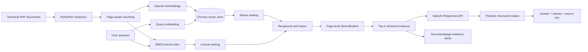

# Design notes

## Problem framing

Engineering teams often work across long manuals, system documentation and troubleshooting guides. The prototype explores whether retrieval-augmented generation (RAG) can make document lookup faster while keeping responses traceable to source evidence.

The project deliberately does **not** connect to or control PLC hardware. It is an information-retrieval assistant only.

## Architecture

## Key engineering choices

### Preserve document and page metadata

Each extracted page is chunked independently. Every chunk carries the original document name and physical PDF page number so the UI can display traceable evidence and page-level retrieval metrics can be calculated.

### Hybrid retrieval instead of embeddings alone

The first real-manual baseline used dense semantic retrieval only. Failure analysis showed that semantic similarity could under-rank exact model identifiers, protocol names and specification-table queries.

The retriever therefore combines:

- dense semantic candidates from ChromaDB;
- BM25 lexical candidates over the same chunks;
- stopword filtering while preserving identifiers such as `S7-1200`, `DC/DC/DC` and `PUT/GET`;
- reciprocal rank fusion (RRF);
- page-level diversification so multiple chunks from one page do not consume the entire Top-k window.

This keeps the design understandable and testable without introducing a large retrieval framework.

### Separate retrieval from generation

The retriever decides which evidence is presented to the model. The generation layer is instructed to use only that evidence. Retrieval quality can therefore be measured independently of writing quality.

### Do not trust free-form citations

The model returns source IDs such as `S1`. The application maps those IDs back to retrieved metadata rather than allowing the model to invent document names or page numbers.

### Structured output

The answer schema is typed with Pydantic. It contains a support flag, concise answer, document-supported checks, caveats and source IDs.

### Explicit insufficient-evidence behaviour

If retrieved passages do not support the question, the assistant should say so rather than fill gaps from general model knowledge. The UI separates cited evidence from the full retrieval trace so low-relevance retrieved candidates are not presented as proof of an unsupported answer.

## Evaluation

Three evaluation layers are kept separate:

1. a small synthetic set that makes the repository reproducible;
2. a real-manual development set used for failure analysis and retrieval iteration;
3. a frozen holdout set created from previously unused manual topics after retrieval design was complete.

The real-manual corpus is one long PDF, so document-level metrics are not useful. Page Recall@1, Page Recall@3, Page Recall@5 and Page MRR are the primary retrieval metrics.

The development set is not an unbiased final test because its cases informed design choices. After the retrieval design was frozen, a separate 12-question holdout set was created from previously unused manual topics, labelled before retrieval was run, and evaluated without further retrieval tuning.

See [`../evaluation/README.md`](../evaluation/README.md) and [`EVALUATION.md`](EVALUATION.md) for the final development and holdout results.

## Limitations

- PDF text extraction quality depends on document structure; scanned PDFs would need OCR.
- Tables can be extracted in reading orders that are less useful for embeddings or lexical retrieval.
- Repeated engineering terminology across neighbouring sections can still cause ranking ambiguity.
- The hybrid retrieval score is a ranking score, not a probability or confidence estimate.
- The prototype does not validate the correctness or safety of vendor procedures.
- It is not connected to live PLCs, industrial networks, SharePoint or Microsoft 365.
- Access control, audit logging, document versioning and production observability are outside the MVP scope.

## Sensible next steps

1. Evaluate a second vendor manual to test cross-document retrieval.
2. Add document version metadata and filters.
3. Test a reranker on difficult neighbouring-section queries using a new development set rather than the frozen holdout.
4. Add SharePoint/Microsoft 365 ingestion behind access controls.
5. Add generation-level groundedness evaluation for supported and unsupported questions.
6. Add a carefully scoped tool/function-calling mode only if it serves a concrete workflow.
